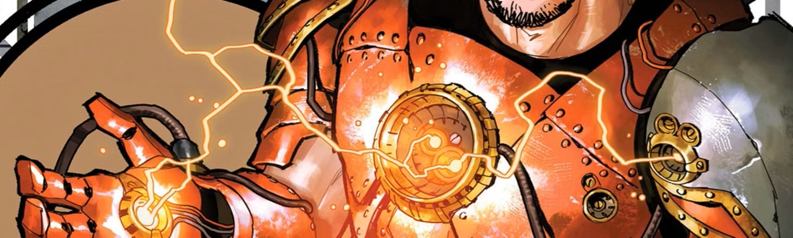

<!-- STARK MODE: ON -->

  

<h1 align="center">Hey, I'm Shrutik.</h1>
<h3 align="center">CS Undergrad | Builder | Occasional Mad Scientist</h3>

  
  
  

---

### so... who's this guy?

CS undergrad who's way too curious about how things work.

- 🤖 Exploring AI, ML & intelligent systems.
- 🏁 Competitive programming addict.
- ⚡ Building things, breaking things, fixing things.
- 🧠 Always collecting ideas bigger than my RAM.

**Currently:** Turning caffeine into questionable engineering decisions.

---

### when I code, I rely on

  

---

### proof i occasionally touch grass 

  
  

---

### the addiction is documented

  

  

---

### brain.exe is working

  

  
  

---

### don't be a stranger, pal

  
  
  

  <i>Genius? Debatable. Builder? Absolutely.</i>
   
  MADE WITH COFFEE & QUESTIONABLE IDEAS.

